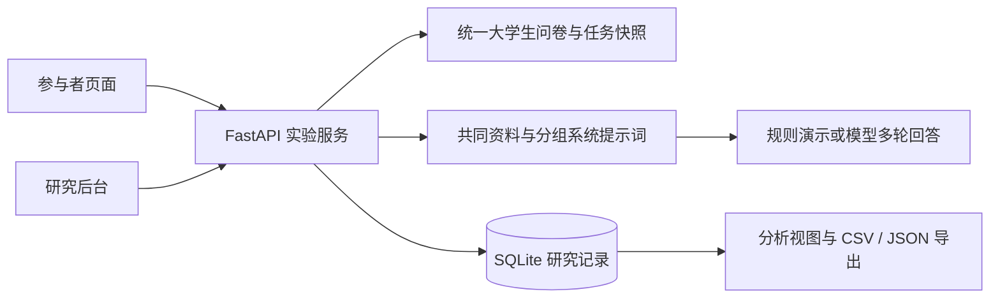

# LENS Lab

[](https://github.com/Xiaoshu0553/lens-lab/actions/workflows/ci.yml)

**信息素养与 AI 主动澄清机制实验平台**

LENS Lab 是挑战杯课题《面向语言表达差异的生成式人工智能信息公平性评测与自适应干预研究》的实验系统，将信息判断前测、资料查证对话、最终决策和研究记录导出串成完整流程。

当前方案为 **university-v1**，仅面向 **18–25 岁、当前在读的专科生和本科生**，聚焦信息素养差异与主动澄清机制，比较无额外澄清提示与加入主动澄清提示两种交互条件下的任务表现。年龄只作为这一群体内的背景变量。规范表达、口语表达等表达风格目前没有被设置为实验条件，不能据此证明语言表达公平性或干预有效性。

> 本仓库提供可运行的软件与候选研究材料，不包含受试者数据库、真实对话或模型密钥；附有可复现的大学生合成展示生成器。问卷、任务及评分仍需研究验证；演示数据不能作为实证结果。

## 功能

- **完整实验流程**：确认年龄和在读学段，完成同一套 30 道信息判断题，与 AI 对话查证资料，再分别选择参加方案与办理方案。
- **统一大学生材料**：18–20、21–23、24–25 三个年龄区间共用一份 30 题候选问卷和一套校园任务；任务具有 4 种私事实情境，年龄不改变材料或评分。
- **平衡分配**：在年龄区间、素养得分区间和当前任务等版本条件内，分配案例情境及标准组／澄清组。
- **两组提示词**：两组使用相同模型、统一资料及完整对话历史；澄清组在对话前额外加入主动澄清提示，缺少影响当前判断的关键事实时先问一个具体问题，补充后继续回答。
- **直接回答**：真实模型根据冻结的统一资料回答用户当前问题，可解释、比较或给出有依据的建议；资料未覆盖的内容应明确说明，不再用固定资料卡话术代替回答。
- **研究后台**：分组与任务表现、问卷逐题分析、过程提醒、只读记录、完整对话及 CSV／JSON 导出。
- **恢复与审计**：请求去重、断线恢复、首次提交冻结、版本快照、UTC 原始时点与北京时间显示。
- **研究者试跑与展示**：真实模型试跑使用独立记录；另有 126 条大学生合成展示记录，明确标注其非真实参与者、非实际模型输出。

## 本地快速启动

需要 **Python 3.11+**。默认 `demo` 模式不需要模型 API key，也不会调用远程模型。

```bash
git clone https://github.com/Xiaoshu0553/lens-lab.git
cd lens-lab
python3 -m venv .venv
.venv/bin/python -m pip install -r requirements.txt
python3 scripts/setup.py
.venv/bin/python -m uvicorn app.main:create_app --factory --host 127.0.0.1 --port 8000
```

macOS／Linux 也可在克隆后运行 `bash start.sh`，自动创建虚拟环境、安装运行依赖并启动。Windows 可使用 `.venv\Scripts\python.exe` 代替上述 `.venv/bin/python`。

| 入口 | 地址 |
| --- | --- |
| 参与者页面 | <http://127.0.0.1:8000/> |
| 研究后台 | <http://127.0.0.1:8000/admin> |
| 研究者试跑 | <http://127.0.0.1:8000/admin/preview> |
| 问卷与任务审查 | <http://127.0.0.1:8000/admin/instruments> |
| 运行信息 | <http://127.0.0.1:8000/api/info> |

管理员用户名为 `admin`。首次运行 `scripts/setup.py` 会生成 `.env`，并在终端显示随机管理员密码；之后可在本机 `.env` 的 `ADMIN_PASSWORD` 中查看。已有 `.env` 不会被覆盖。后台网页登录有效期为八小时。

初次启动会创建数据库及候选任务，**不会自动生成参与者样本或填充统计图表**。可通过研究者试跑检查流程，通过参与者入口创建本地演示记录。新安装默认数据库位于 `university-data/lens.sqlite3`。已有 `.env` 不会自动改路径，升级时需改用独立的新库。

## 运行模式与模型配置

| `STUDY_MODE` | 用途 | 模型与任务 |
| --- | --- | --- |
| `demo` | 本地功能演示 | 内置规则模拟回答与澄清；自动创建候选任务；不调用真实模型 |
| `pilot` | 真实模型预测试 | 调用配置的模型服务；自动创建候选任务；保留预测试标记 |
| `live` | 材料定稿后的正式收集 | 调用配置的模型服务；必须设置参与邀请码，并在后台创建正式任务 |

使用真实模型时，停止服务、编辑 `.env`，然后重新启动。例如使用本地 OpenAI Chat Completions 兼容服务：

```dotenv
STUDY_MODE=pilot
MODEL_BASE_URL=http://127.0.0.1:11434/v1
MODEL_NAME=your-installed-model
MODEL_API_KEY=
MODEL_MAX_TOKENS=1600
CLARIFICATION_STRATEGY=prompt
```

服务须提供 `{MODEL_BASE_URL}/chat/completions` 接口。本地模型需自行安装并启动；远程服务需填写其实际地址、模型名称与 `MODEL_API_KEY`。当前统一使用提示词澄清策略；旧配置 `CLARIFICATION_STRATEGY=module` 兼容映射为 `prompt`。配置模板见 [`.env.example`](.env.example)。真实模型预测试建议设置随机 `PARTICIPANT_ACCESS_CODE`，限制创建会话。

`MODEL_MAX_TOKENS` 默认 1600。模型因输出上限截断时，本轮返回可重试错误，不保存不完整回复，也不计入有效对话轮次。

标准组不额外施加主动澄清要求，模型仍可能自然追问。两组共用澄清输出标记，后台按识别到的标记计数；模型漏标会漏计，完整对话仍需用于离线审核。

切换 `live` 不会把候选任务自动变成正式任务。正式收集前应固定问卷、任务、评分、模型配置及纳入规则，并使用独立数据库保存不同研究阶段的数据。

当前参与者入口在所有运行模式下仅接受三个大学生年龄区间、在读专科／本科，并要求明确勾选在读及年龄确认。页面确认不等于实际核验学籍；研究者仍须在招募与同意流程中落实纳入标准。旧跨年龄入口与配置仅作历史兼容，不适用于当前招募。

## Docker

需要 Docker Engine 和 Compose。先生成 `.env`，然后启动默认服务：

```bash
python3 scripts/setup.py
mkdir -p university-data synthetic-datasets
docker compose up -d --build
docker compose ps
```

应用绑定到 `127.0.0.1:8000`，数据库通过 `university-data/` 持久化；Compose 内部使用 `/app/data/lens.sqlite3`，覆盖本地 `.env` 的相对数据库路径。HTTPS、反向代理、备份与生产配置见 [部署说明](deploy/README.md)。

`compose.showcase.yaml` 用于隔离的大学生合成展示实例，在 `university-showcase-data/showcase.sqlite3` 中创建当前 126 条合成记录。数据来自当前冻结材料和确定性模拟生成器，不调用真实模型，也不代表实验结果。普通 `demo` 启动仍从空记录开始。

已有合成展示站点时，可用 `compose.preview.yaml` 和独立 API 前缀将 `/admin/preview` 接到真实模型实例。展示首页和真实试跑均使用当前大学生材料，分别写入独立的新库；旧跨年龄数据库保留为历史归档，不导入当前 126 条展示。此入口仅供已登录管理员试跑，配置与路由见 [部署说明](deploy/README.md)。

## 架构与目录

系统使用 FastAPI、SQLite 和原生 HTML／CSS／JavaScript，没有前端构建步骤。



```text
app/                  实验 API、问卷任务、多轮对话、评分与导出
static/               参与者端、管理员端及样式
scripts/              本地配置生成、材料审查导出
tests/                Python 与 Node.js 验证
deploy/               HTTPS 与反向代理部署示例
docs/                 研究设计与数据口径
compose.yaml          默认容器服务
compose.preview.yaml  与展示站点隔离的真实模型试跑覆盖配置
compose.showcase.yaml  隔离合成展示实例
.env.example          配置模板
```

## 验证

安装开发依赖后运行以下命令。JavaScript 验证需要 Node.js，建议使用 Node.js 22+。

```bash
.venv/bin/python -m pip install -r requirements-dev.txt
.venv/bin/python -m pytest -q
node --check static/app.js
node --check static/admin.js
node --check static/admin-login.js
node --check static/admin-synthetic.js
node tests/frontend_state.test.cjs
node --test tests/frontend_*.test.js
```

测试覆盖实验流程、分组提示词与对话上下文、会话恢复、评分、管理员认证、统计口径、导出和展示隔离。软件测试通过只说明所测程序行为符合预期，不能证明量表有效、与旧材料等值或干预存在因果效果。

## 研究与数据边界

任务表现按会话开始时冻结的选项及评分计算，首次提交后不可人工改分。任务完成时长从前测结束后创建会话开始，包含阅读、等待、停留及提交前反馈，不包含前测答题时间。默认分析导出按当前版本、完整问卷和最终客观提交自动纳入，不依赖人工审核状态。

三个大学生年龄区间使用同一份 30 题问卷，不存在当前三份年龄适配卷；`anchor_score` 仅为兼容分项，不说明已与旧跨年龄量表等值。当前学生版与旧材料、`demo`／`pilot`／`live` 数据分别保存和解释。演示样本、模拟对话和人为设定的目标均值均不能作为真实参与者结果或模型效果证据。详细设计、计数和导出口径见 [研究设计与记录说明](docs/research-design.md)。

仓库忽略 `.env`、数据库、运行数据与合成来源包。部署者仍须管理知情同意、访问权限、数据留存和删除。使用远程模型时，对话会发送到所配置的服务；请勿让参与者提交姓名、联系方式等真实个人隐私。

## 使用与许可

当前未附加开源许可证。公开代码不代表已授予复用、修改或分发许可；如需使用，请先取得权利人许可。可通过 [GitHub Issues](https://github.com/Xiaoshu0553/lens-lab/issues) 报告问题，但请勿附上密钥、数据库或参与者对话。
