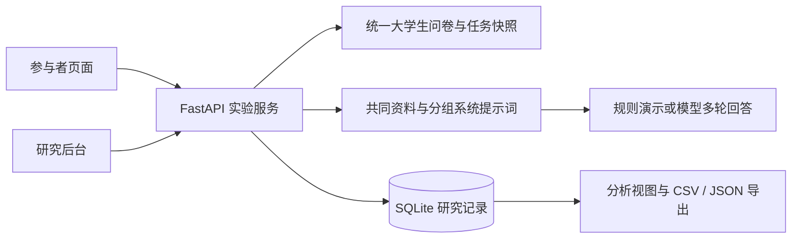

# LENS Lab · 翻译信息公平性研究平台

[](https://github.com/Xiaoshu0553/lens-lab/actions/workflows/ci.yml)

**挑战杯项目：《从“直接翻译”到“主动澄清”：面向翻译使用者的信息公平性研究与促进——基于生成式人工智能轻量化优化模块的设计与实证》——以中国矿业大学翻译用户为例**

当前处于第一阶段“公平性基线测试”，只开放 S 直接翻译与 A 主动澄清两组。先检验不同翻译能力群体的澄清收益是否不同，再根据实证结果另行设计针对性优化模块；当前没有启用优化条件。

当前参与者入口与研究后台采用翻译任务流程：完成翻译能力候选问卷，与 AI 讨论同一段英语小说材料，编辑并提交中文译文，由研究后台发起统一盲评。旧版校园信息判断任务保留为历史入口，其记录和合成展示数据不纳入翻译研究。

新安装默认数据库为 `translation-data/lens.sqlite3`。已有 `.env` 不会被覆盖；升级时请主动改用独立数据库。新版使用独立的翻译会话表，已有数据库中的旧记录不会转换成翻译记录。

## 当前平台功能

- **能力评定**：客观翻译常识、语境判断、译文鉴赏题用于能力分层；主观自评另行保存，不直接加入客观得分。
- **当前两种实验条件**：S 直接翻译、A 主动澄清。在能力层内平衡分配，正式参与者不能自选条件；研究者可独立试跑。
- **共同翻译任务**：各能力组使用同一英语段落、翻译要求与补充资料；补充资料供参与者阅读，模型根据对话获得信息，避免条件之间暗中增加标准答案。
- **后续优化阶段**：模块设计须建立在第一阶段的实际研究结论上，当前不开放优化组，也不预定优化策略。
- **译文工作台**：保留多轮对话、自动保存草稿、断线恢复、最终译文冻结及退出删除。
- **多模型统一盲评**：至少五个不同 AI 模型各自按相同五维量规完整评分。先按维度权重计算每个模型总分，去掉一个最高总分和一个最低总分，再将剩余模型的预设权重归一化后加权平均；保存所有原始分数、依据和剔除标记。
- **公平性分析**：按能力层和条件查看实际质量均值、组间差距、澄清收益及样本数。没有数据时显示空值，不预填预期研究结论。
- **审查与导出**：材料版本、正式材料冻结、完整译文与对话、逐专家评分及 CSV／JSON 导出；研究者试跑和演示记录单独标识。

> 量表、任务和量规均为候选研究材料，需要预测试与专家审查。当前评审使用不同模型，而非同一模型的五个角色。各模型仍可能存在共同训练来源或系统偏差，多个模型与去除极值不能保证偏差抵消或评分公平。`demo` 为规则模拟，不产生研究质量分。平台不会预设“高能力用户受益更多”或“优化后各组等效”的结论。

翻译对话与评审均通过实际模型 API 调用实现，真实预测试应使用 `pilot`；`demo` 继续保留为明确标识的规则演示。后台分别展示配置状态与连通验证结果，配置地址、密钥和模型名称本身不表示已经接通。

## 启动与入口

```bash
python3 -m venv .venv
.venv/bin/python -m pip install -r requirements.txt
python3 scripts/setup.py
.venv/bin/python -m uvicorn app.main:create_app --factory --host 127.0.0.1 --port 8000
```

| 入口 | 地址 |
| --- | --- |
| 翻译任务参与者 | <http://127.0.0.1:8000/> |
| 翻译研究后台 | <http://127.0.0.1:8000/admin> |
| 研究者试跑 | <http://127.0.0.1:8000/admin/preview> |
| 翻译问卷、任务与量规审查 | <http://127.0.0.1:8000/admin/instruments> |
| 翻译运行信息 | <http://127.0.0.1:8000/api/translation/info> |
| 历史校园任务 | <http://127.0.0.1:8000/legacy> |
| 历史校园研究后台 | <http://127.0.0.1:8000/admin/legacy> |

管理员用户名为 `admin`，密码由 `scripts/setup.py` 首次生成。默认 `STUDY_MODE=demo`；真实模型预测试使用 `pilot`，正式收集使用 `live`，填写模型接口和参与邀请码后，还需要在翻译后台审查并冻结材料。详见 [翻译研究流程与评分口径](docs/translation-study.md)。

## 配置对话模型与多模型评审

进入研究后台的模型配置面板，分别填写一个翻译对话模型和至少五个不同的评审模型。当前云端接口使用 Chat Completions 兼容协议；填写其 API 根地址，不附加 `/chat/completions`。每个评审模型都有自己的接口地址、模型名称、API 密钥与预设权重；多个模型可通过同一兼容网关调用，但不得用同一个模型配置五个不同角色代替。默认每个模型权重为 `1`，正式收集前固定权重与量规。

保存后执行连通检查，逐一查看模型实际返回结果。配置不完整时可保存草案，但无法发起多模型综合评分；某模型失败或缺少评分时，不使用其余模型临时出分。模型配置变更后，新会话使用新配置快照，旧记录保留原模型与权重，避免混合不同评分口径。

后台将密钥保存在本机忽略版本管理的 `.translation-models.json`，不在读取配置或记录导出时返回密钥。请通过后台表单填写，无需把密钥发到聊天中。容器部署应为该私有配置提供持久化存储，不能把它加入源代码镜像。

## 历史平台参考

以下内容记录上一版 `university-v1` 校园信息判断实验，保留用于维护历史入口与部署。其问卷、决策评分、126 条合成数据、两组分析和旧 API 均不属于当前翻译研究；当前操作以本页上半部分和翻译研究说明为准。

<details>
<summary>展开历史 university-v1 安装、功能及维护说明</summary>

## 本地快速启动

需要 **Python 3.11+**。默认 `demo` 模式不需要模型 API key，也不会调用远程模型。

```bash
git clone https://github.com/Xiaoshu0553/lens-lab.git
cd lens-lab
python3 -m venv .venv
.venv/bin/python -m pip install -r requirements.txt
python3 scripts/setup.py
.venv/bin/python -m uvicorn app.main:create_app --factory --host 127.0.0.1 --port 8000
```

macOS／Linux 也可在克隆后运行 `bash start.sh`，自动创建虚拟环境、安装运行依赖并启动。Windows 可使用 `.venv\Scripts\python.exe` 代替上述 `.venv/bin/python`。

| 入口 | 地址 |
| --- | --- |
| 参与者页面 | <http://127.0.0.1:8000/> |
| 研究后台 | <http://127.0.0.1:8000/admin> |
| 研究者试跑 | <http://127.0.0.1:8000/admin/preview> |
| 问卷与任务审查 | <http://127.0.0.1:8000/admin/instruments> |
| 运行信息 | <http://127.0.0.1:8000/api/info> |

管理员用户名为 `admin`。首次运行 `scripts/setup.py` 会生成 `.env`，并在终端显示随机管理员密码；之后可在本机 `.env` 的 `ADMIN_PASSWORD` 中查看。已有 `.env` 不会被覆盖。后台网页登录有效期为八小时。

初次启动会创建数据库及候选任务，**不会自动生成参与者样本或填充统计图表**。可通过研究者试跑检查流程，通过参与者入口创建本地演示记录。新安装默认数据库位于 `university-data/lens.sqlite3`。已有 `.env` 不会自动改路径，升级时需改用独立的新库。

## 运行模式与模型配置

| `STUDY_MODE` | 用途 | 模型与任务 |
| --- | --- | --- |
| `demo` | 本地功能演示 | 内置规则模拟回答与澄清；自动创建候选任务；不调用真实模型 |
| `pilot` | 真实模型预测试 | 调用配置的模型服务；自动创建候选任务；保留预测试标记 |
| `live` | 材料定稿后的正式收集 | 调用配置的模型服务；必须设置参与邀请码，并审查、冻结自动准备的独立 live 候选任务 |

使用真实模型时，停止服务、编辑 `.env`，然后重新启动。例如使用本地 OpenAI Chat Completions 兼容服务：

```dotenv
STUDY_MODE=pilot
MODEL_BASE_URL=http://127.0.0.1:11434/v1
MODEL_NAME=your-installed-model
MODEL_API_KEY=自行填写API
MODEL_MAX_TOKENS=1600
CLARIFICATION_STRATEGY=prompt
```

服务须提供 `{MODEL_BASE_URL}/chat/completions` 接口，并支持 `response_format={"type":"json_object"}` 的 JSON 输出。本地模型需自行安装并启动；远程服务需填写其实际地址、模型名称与 `MODEL_API_KEY`。当前统一使用提示词澄清策略；旧配置 `CLARIFICATION_STRATEGY=module` 兼容映射为 `prompt`。配置模板见 [`.env.example`](.env.example)。真实模型预测试建议设置随机 `PARTICIPANT_ACCESS_CODE`，限制创建会话。

`MODEL_MAX_TOKENS` 默认 1600。模型因输出上限截断、异常中断，或未返回有效对话结构时，本轮返回可重试错误，不保存不完整回复，也不计入有效对话轮次。

标准组不额外施加主动澄清要求，模型仍可能自然追问。两组共用 JSON 对话输出协议，由模型输出正文及 `answer`／`clarification` 类型；服务端校验后保存正文及回复动作，页面只展示自然语言。历史回复保留类型后再发送给模型，避免多轮中丢失分类约定。类型仍由模型判断，完整对话仍需用于离线审核。真实模型提示词更新为 `answer-dialogue-v7`／`clarify-dialogue-v5`；旧试跑保留原文和版本，需开始新会话继续测试。离线演示保持原有 v6／v4 标识、展示数据与统计口径。

切换 `live` 会准备独立的 live 候选任务，但不会自动完成研究审查和材料定稿。正式收集前应固定问卷、任务、评分、模型配置及纳入规则，并使用独立数据库保存不同研究阶段的数据。

当前参与者入口在所有运行模式下仅接受三个大学生年龄区间、在读专科／本科，并要求明确勾选在读及年龄确认。页面确认不等于实际核验学籍；研究者仍须在招募与同意流程中落实纳入标准。旧跨年龄入口与配置仅作历史兼容，不适用于当前招募。

## Docker

需要 Docker Engine 和 Compose。先生成 `.env`，然后启动默认服务：

```bash
python3 scripts/setup.py
mkdir -p university-data
docker compose up -d --build
docker compose ps
```

应用绑定到 `127.0.0.1:8000`，数据库通过 `university-data/` 持久化；Compose 内部使用 `/app/data/lens.sqlite3`，覆盖本地 `.env` 的相对数据库路径。HTTPS、反向代理、备份与生产配置见 [部署说明](deploy/README.md)。

`compose.showcase.yaml` 用于隔离的大学生合成展示实例，在 `university-showcase-data/showcase.sqlite3` 中创建当前 126 条合成记录。当前批次为 `student-126-20261022-v4`，不调用真实模型；沿用V3的个人数据、对话正文、动作、时点和线索计数，仅新增逐轮回复耗时估计。A组每条2–8次、S组1–5次资料线索，范围重叠，允许间隔复核；A只追问尚未提供的事实0–2次，S不主动追问。每次线索对应实际模板正文，人工过程差异不构成真实干预效应，也不按均分调节个人结果。AI平均用时由回复长度、类型及固定seed逐轮估算，记录JSON及归档保存估计来源与版本；实测模型延迟和前测耗时仍为空，估计值不作为性能评测。真实记录继续读取实测日志，缺失不补。普通 `demo` 启动仍从空记录开始。

已有合成展示站点时，可用 `compose.preview.yaml` 和独立 API 前缀将 `/admin/preview` 接到真实模型实例。展示首页和真实试跑均使用当前大学生材料，分别写入独立的新库；旧跨年龄库、旧 600 条来源包及 V1、V2、V3 展示库先转存到服务器外私有备份，核验后从服务器移除，不导入当前 V4 展示；服务器工作目录只保留两个在用学生数据目录。此入口仅供已登录管理员试跑，配置与路由见 [部署说明](deploy/README.md)。

## 架构与目录

系统使用 FastAPI、SQLite 和原生 HTML／CSS／JavaScript，没有前端构建步骤。



```text
app/                  实验 API、问卷任务、多轮对话、评分与导出
static/               参与者端、管理员端及样式
scripts/              本地配置生成、材料审查导出
tests/                Python 与 Node.js 验证
deploy/               HTTPS 与反向代理部署示例
docs/                 研究设计与数据口径
compose.yaml          默认容器服务
compose.preview.yaml  与展示站点隔离的真实模型试跑覆盖配置
compose.showcase.yaml  隔离合成展示实例
.env.example          配置模板
```

## 验证

安装开发依赖后运行以下命令。JavaScript 验证需要 Node.js，建议使用 Node.js 22+。

```bash
.venv/bin/python -m pip install -r requirements-dev.txt
.venv/bin/python -m pytest -q
node --check static/app.js
node --check static/admin.js
node --check static/admin-login.js
node --check static/admin-synthetic.js
node tests/frontend_state.test.cjs
node --test tests/frontend_*.test.js
```

测试覆盖实验流程、分组提示词与对话上下文、会话恢复、评分、管理员认证、统计口径、导出和展示隔离。软件测试通过只说明所测程序行为符合预期，不能证明量表有效、与旧材料等值或干预存在因果效果。

## 研究与数据边界

任务表现按会话开始时冻结的选项及评分计算，首次提交后不可人工改分。任务完成时长从前测结束后创建会话开始，包含阅读、等待、停留及提交前反馈，不包含前测答题时间。默认分析导出按当前版本、完整问卷和最终客观提交自动纳入，不依赖人工审核状态。

三个大学生年龄区间使用同一份 30 题问卷，不存在当前三份年龄适配卷；`anchor_score` 仅为兼容分项，不说明已与旧跨年龄量表等值。当前学生版与旧材料、`demo`／`pilot`／`live` 数据分别保存和解释。演示样本、模拟对话和人为设定的目标均值均不能作为真实参与者结果或模型效果证据。详细设计、计数和导出口径见 [研究设计与记录说明](docs/research-design.md)。完整操作、功能逻辑、澄清提示词和数据字典见 [大学生版平台说明书](docs/manual/README.md)。

仓库忽略 `.env`、数据库、运行数据与合成来源包。部署者仍须管理知情同意、访问权限、数据留存和删除。使用远程模型时，对话会发送到所配置的服务；请勿让参与者提交姓名、联系方式等真实个人隐私。

## 使用与许可

当前未附加开源许可证。公开代码不代表已授予复用、修改或分发许可；如需使用，请先取得权利人许可。可通过 [GitHub Issues](https://github.com/Xiaoshu0553/lens-lab/issues) 报告问题，但请勿附上密钥、数据库或参与者对话。


</details>
