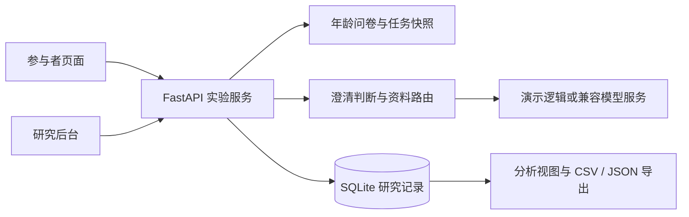

# LENS Lab

[](https://github.com/Xiaoshu0553/lens-lab/actions/workflows/ci.yml)

**信息素养与 AI 主动澄清机制实验平台**

LENS Lab 是挑战杯课题《面向语言表达差异的生成式人工智能信息公平性评测与自适应干预研究》的实验系统，将信息判断前测、资料查证对话、最终决策和研究记录导出串成完整流程。

当前实现聚焦**信息素养差异、年龄情境和主动澄清机制**，比较标准资料查证与主动澄清两种交互条件下的任务表现。规范表达、口语表达等表达风格目前没有被设置为实验条件，不能据此证明语言表达公平性或干预有效性。

> 本仓库提供可运行的软件与候选研究材料，不包含受试者数据库、真实对话、模型密钥或历史合成数据包。问卷、任务及评分仍需研究验证；演示数据不能作为实证结果。

## 功能

- **完整实验流程**：选择年龄区间，完成 30 道信息判断题，与 AI 逐项查证资料，再分别选择参加方案与办理方案。
- **年龄情境**：9 个年龄区间、9 份候选问卷、9 套任务；每套任务具有 4 种私事实情境。
- **平衡分配**：在年龄区间、素养得分区间和当前任务等版本条件内，分配案例情境及标准组／澄清组。
- **主动澄清**：支持独立判断模块与提示词策略，按已有对话检查缺少的关键个案事实。
- **资料约束**：模型参与资料路由等判断，资料正文来自冻结资料卡；资料未覆盖问题时明确说明。
- **研究后台**：分组与任务表现、问卷逐题分析、过程提醒、只读记录、完整对话及 CSV／JSON 导出。
- **恢复与审计**：请求去重、断线恢复、首次提交冻结、版本快照、UTC 原始时点与北京时间显示。
- **研究者试跑**：独立试跑记录不占普通参与者分配名额，也不进入普通分析导出。

## 本地快速启动

需要 **Python 3.11+**。默认 `demo` 模式不需要模型 API key，也不会调用远程模型。

```bash
git clone https://github.com/Xiaoshu0553/lens-lab.git
cd lens-lab
python3 -m venv .venv
.venv/bin/python -m pip install -r requirements.txt
python3 scripts/setup.py
.venv/bin/python -m uvicorn app.main:create_app --factory --host 127.0.0.1 --port 8000
```

macOS／Linux 也可在克隆后运行 `bash start.sh`，自动创建虚拟环境、安装运行依赖并启动。Windows 可使用 `.venv\Scripts\python.exe` 代替上述 `.venv/bin/python`。

| 入口 | 地址 |
| --- | --- |
| 参与者页面 | <http://127.0.0.1:8000/> |
| 研究后台 | <http://127.0.0.1:8000/admin> |
| 研究者试跑 | <http://127.0.0.1:8000/admin/preview> |
| 问卷与任务审查 | <http://127.0.0.1:8000/admin/instruments> |
| 运行信息 | <http://127.0.0.1:8000/api/info> |

管理员用户名为 `admin`。首次运行 `scripts/setup.py` 会生成 `.env`，并在终端显示随机管理员密码；之后可在本机 `.env` 的 `ADMIN_PASSWORD` 中查看。已有 `.env` 不会被覆盖。后台网页登录有效期为八小时。

初次启动会创建数据库及候选任务，**不会自动生成参与者样本或填充统计图表**。可通过研究者试跑检查流程，通过参与者入口创建本地演示记录。默认数据库位于 `data/lens.sqlite3`。

## 运行模式与模型配置

| `STUDY_MODE` | 用途 | 模型与任务 |
| --- | --- | --- |
| `demo` | 本地功能演示 | 内置规则逻辑；自动创建候选任务；使用模块澄清策略 |
| `pilot` | 真实模型预测试 | 调用配置的模型服务；自动创建候选任务；保留预测试标记 |
| `live` | 材料定稿后的正式收集 | 调用配置的模型服务；必须设置参与邀请码，并在后台创建正式任务 |

使用真实模型时，停止服务、编辑 `.env`，然后重新启动。例如使用本地 OpenAI Chat Completions 兼容服务：

```dotenv
STUDY_MODE=pilot
MODEL_BASE_URL=http://127.0.0.1:11434/v1
MODEL_NAME=your-installed-model
MODEL_API_KEY=
CLARIFICATION_STRATEGY=module
```

服务须提供 `{MODEL_BASE_URL}/chat/completions` 接口。本地模型需自行安装并启动；远程服务需填写其实际地址、模型名称与 `MODEL_API_KEY`。`CLARIFICATION_STRATEGY=prompt` 可切换为提示词澄清策略。配置模板见 [`.env.example`](.env.example)。真实模型预测试建议设置随机 `PARTICIPANT_ACCESS_CODE`，限制创建会话。

切换 `live` 不会把候选任务自动变成正式任务。正式收集前应固定问卷、任务、评分、模型配置及纳入规则，并使用独立数据库保存不同研究阶段的数据。

`pilot`／`live` 默认关闭未成年人入口。开放 12–17 岁入口需配置 `MINOR_ACCESS_CODE`；12–14 岁组还需 HTTPS 的 `UNDER14_PRIVACY_NOTICE_URL`。研究者须另行完成相应知情同意流程，页面勾选和邀请码无法替代实际记录。

## Docker

需要 Docker Engine 和 Compose。先生成 `.env`，然后启动默认服务：

```bash
python3 scripts/setup.py
mkdir -p data synthetic-datasets
docker compose up -d --build
docker compose ps
```

应用绑定到 `127.0.0.1:8000`，数据库通过 `data/` 持久化。HTTPS、反向代理、备份与生产配置见 [部署说明](deploy/README.md)。

`compose.showcase.yaml` 用于隔离的合成数据展示实例，依赖另行提供且通过校验的来源包；本仓库不附带该包，首次体验请使用默认 Compose 或本地 `demo`。

## 架构与目录

系统使用 FastAPI、SQLite 和原生 HTML／CSS／JavaScript，没有前端构建步骤。



```text
app/                  实验 API、问卷任务、资料路由、评分与导出
static/               参与者端、管理员端及样式
scripts/              本地配置生成、材料审查导出
tests/                Python 与 Node.js 验证
deploy/               HTTPS 与反向代理部署示例
docs/                 研究设计与数据口径
compose.yaml          默认容器服务
compose.showcase.yaml  隔离合成展示实例
.env.example          配置模板
```

## 验证

安装开发依赖后运行以下命令。JavaScript 验证需要 Node.js，建议使用 Node.js 22+。

```bash
.venv/bin/python -m pip install -r requirements-dev.txt
.venv/bin/python -m pytest -q
node --check static/app.js
node --check static/admin.js
node --check static/admin-login.js
node --check static/admin-synthetic.js
node tests/frontend_state.test.cjs
node --test tests/frontend_*.test.js
```

测试覆盖实验流程、资料路由、会话恢复、评分、管理员认证、统计口径、导出和展示隔离。软件测试通过只说明所测程序行为符合预期，不能证明量表有效、跨年龄等值或干预存在因果效果。

## 研究与数据边界

任务表现按会话开始时冻结的选项及评分计算，首次提交后不可人工改分。任务完成时长从前测结束后创建会话开始，包含阅读、等待、停留及提交前反馈，不包含前测答题时间。默认分析导出按当前版本、完整问卷和最终客观提交自动纳入，不依赖人工审核状态。

不同年龄问卷的原始百分数、不同任务的分数，以及 `demo`／`pilot`／`live` 数据不能直接合并作推断。共同题只提供后续校准基础。演示样本、模拟对话和人为设定的目标均值均不能作为真实参与者结果或模型效果证据。详细设计、计数和导出口径见 [研究设计与记录说明](docs/research-design.md)。

仓库忽略 `.env`、数据库、运行数据与合成来源包。部署者仍须管理知情同意、访问权限、数据留存和删除。使用远程模型时，对话会发送到所配置的服务；请勿让参与者提交姓名、联系方式等真实个人隐私。

## 使用与许可

当前未附加开源许可证。公开代码不代表已授予复用、修改或分发许可；如需使用，请先取得权利人许可。可通过 [GitHub Issues](https://github.com/Xiaoshu0553/lens-lab/issues) 报告问题，但请勿附上密钥、数据库或参与者对话。
